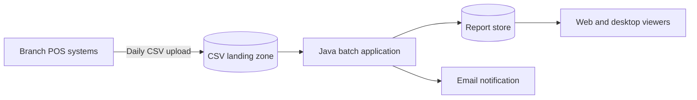
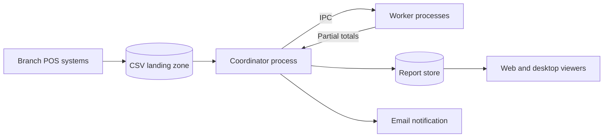
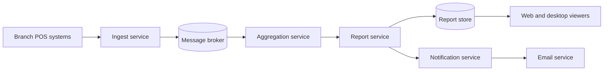

# ATAM-Style Evaluation: Release 1 Architecture

## 1. Business Drivers

Angkor Mart needs a monthly sales report for each branch and the whole chain by the morning of the second day of the following month. The system must process approximately 3 million rows per month, handle branch network failures, protect branch-specific data, and support future output formats.

The primary architectural drivers are:

* **QA-1 Performance:** Process approximately 3 million rows within 60 seconds.
* **QA-3 Availability:** Continue processing available branch data when another branch's file is late.
* **QA-4 Modifiability:** Add a report format within two person-days.
* **QA-5 Security:** Branch managers can access their own branch's report only.
* **QA-2 Scalability:** Adding a fourth branch increases processing time by no more than 35%.
* **QA-6 Testability:** Engine tests complete within 30 seconds.

These are proposed targets and must be confirmed against `quality-scenarios.md`.

## 2. Candidate Architectures

### Candidate A: Modular Monolith Batch

In this candidate, ingestion, aggregation, and rendering run inside one Java application. Packages provide logical separation without requiring separate deployment units.

### Candidate B: Process Pipeline

The coordinator divides input files or row ranges among workers. Workers return partial totals for merging. IPC introduces serialization, process-management, and failure-recovery requirements.

### Candidate C: Event-Driven Microservices

Services can be deployed and scaled independently. The architecture requires a broker, message schemas, monitoring, retry policies, and idempotent consumers.

## 3. Scenario Analysis

Ratings are relative architectural judgments, not measured test results.

| Scenario           | A: Monolith                                                                                         | B: Pipeline                                                                                       | C: Microservices                                                                                         |
| ------------------ | --------------------------------------------------------------------------------------------------- | ------------------------------------------------------------------------------------------------- | -------------------------------------------------------------------------------------------------------- |
| QA-1 Performance   | **++** — avoids IPC overhead and can parallelize parsing within one JVM.                            | **+** — workers can process files concurrently, but IPC and process startup add overhead.         | **−** — message serialization and broker throughput can become bottlenecks without batching.             |
| QA-2 Scalability   | **+** — can add threads and increase server resources, but scaling is mainly within one deployment. | **++** — additional worker processes can increase parallel capacity.                              | **++** — individual services can scale independently when demand is uneven.                              |
| QA-3 Availability  | **+** — can skip a missing branch file and produce an explicitly incomplete report.                 | **+** — workers can process available files, but failed processes require recovery.               | **++** — durable queues can buffer work during temporary service failures if configured correctly.       |
| QA-4 Modifiability | **+** — package boundaries and the renderer interface isolate output formats.                       | **0** — separate processes isolate responsibilities but require IPC contracts to evolve.          | **+** — service boundaries isolate changes, but distributed contracts make coordinated changes harder.   |
| QA-5 Security      | **+** — one application can enforce branch-level authorization centrally.                           | **0** — access control must cover coordinator, workers, and IPC endpoints.                        | **−** — more network endpoints, credentials, and service policies increase the attack surface.           |
| QA-6 Testability   | **++** — unit tests can exercise model, parser, aggregation, and renderers in-process.              | **0** — unit tests are straightforward, but integration tests must cover IPC and worker failures. | **−** — end-to-end tests need a broker and several services, increasing test setup complexity.           |
| Cost and skills    | **++** — lowest initial infrastructure cost and fits a small Java team.                             | **0** — requires process supervision, IPC, and additional operational skills.                     | **−** — requires broker operations, distributed tracing, service deployment, and stronger DevOps skills. |

## 4. QA-1 Performance Estimates

### Assumptions

These calculations are estimates, not benchmarks.

1. Monthly input contains 3,000,000 valid rows.
2. Parsing and validation cost 5 microseconds per row on one CPU core.
3. The serial aggregation merge takes 2 seconds.
4. Report rendering takes 1 second.
5. The server has 8 available CPU cores.
6. Candidate A uses 8 parser threads; Candidate B uses 4 worker processes.
7. Candidate C batches 1,000 rows per broker message in the main estimate.
8. Candidate C's illustrative broker throughput is 50,000 messages per second.
9. For Candidate B, worker startup takes 0.5 seconds and occurs outside the main processing critical path except for that stated overhead.
10. Estimates exclude disk contention, garbage collection, network transfer of the original CSV files, and unusually expensive report generation.

### Base parsing time

$$
T_p = 3{,}000{,}000 \times 5\ \mu s = 15\ seconds
$$

### Candidate A: Modular Monolith

Assume eight equally loaded parser threads and a serial aggregation/rendering phase of 3 seconds.

Using Amdahl's law, let the parallel fraction be \(P=15/18\), serial fraction \(S=3/18\), and thread count \(N=8\).

$$
T_A = 15/8 + 2 + 1 = 4.875\ seconds
$$

The idealized estimate is approximately **4.9 seconds**, meeting the 60-second target. Actual performance must be benchmarked.

### Candidate B: Process Pipeline

Assume four equally loaded workers, each processing one quarter of the rows, with 0.5 seconds of worker-startup overhead.

$$
T_B = 0.5 + 15/4 + 2 + 1 = 7.25\ seconds
$$

The estimate is approximately **7.3 seconds**, meeting the target before accounting for IPC and serialization overhead. A real implementation must measure these costs.

### Candidate C: Event-Driven Microservices

With one row per message:

$$
3{,}000{,}000/50{,}000 = 60\ seconds
$$

The broker alone consumes the entire performance budget, leaving no time for aggregation or rendering. This configuration therefore fails the 60-second end-to-end target.

With 1,000 rows per message:

$$
3{,}000{,}000/1{,}000 = 3{,}000\ messages
$$

$$
3{,}000/50{,}000 = 0.06\ seconds
$$

Broker transfer time is approximately 0.06 seconds under the assumed throughput. Total runtime cannot be concluded from this figure alone; parsing, service processing, aggregation, rendering, and delivery must also be measured.

## 5. Sensitivity Points

* **S1 — Per-row processing cost:** Increasing parsing cost from 5 to 20 microseconds multiplies the serial parsing workload by four. QA-1 worsens for all candidates.
* **S2 — Available CPU cores:** Reducing Candidate A from eight effective parser cores to two increases its ideal parsing time from 1.875 to 7.5 seconds. QA-1 worsens, although the estimate remains under 60 seconds before other overheads.
* **S3 — Broker batch size:** Candidate C with one row per message requires 60 seconds of broker time at 50,000 messages/second; 1,000 rows per message reduces the estimate to 0.06 seconds. QA-1 is highly sensitive to batching.
* **S4 — Branch upload delay:** If a branch file misses the cutoff, a policy that waits longer delays publication, improving completeness but worsening QA-3's delivery time.
* **S5 — Number of branches:** More branches increase input volume and potentially parallel work. QA-2 depends on available resources and whether coordination overhead remains small.

## 6. Trade-Off Points

* **T1 — Parallelism versus simplicity:** Candidate B can improve processing capacity through worker processes, but IPC and failure recovery add complexity. This benefits QA-1 and potentially QA-2 while making QA-6 harder.
* **T2 — Durable broker versus infrastructure cost:** Candidate C can buffer events and support service recovery, benefiting QA-3, but adds infrastructure, serialization, security configuration, and operational cost.
* **T3 — Single deployment versus independent scaling:** Candidate A simplifies deployment and authorization, supporting QA-5 and QA-6. Candidate C offers more independent scaling for QA-2 but requires consistent security policies across services.

## 7. Risks and Non-Risks

### Risk Theme 1: Delivery Deadline and Missing Files

**Business driver:** The report must be ready on the morning of day 2 of the following month.

Risks:

* A late branch file can make a report incomplete if the cutoff policy is unclear.
* Candidate B or C can miss the deadline if process coordination, IPC, or broker throughput becomes a bottleneck.

Non-risks:

* A single invalid CSV row need not stop processing if the parser rejects the row, records its location, and continues.
* A missing branch file need not block all reporting if the business accepts a clearly labelled partial report and a later corrected version.

### Risk Theme 2: Access Control and Operational Complexity

**Business driver:** Branch managers may access their own branch's report only.

Risks:

* Candidate C has more network endpoints and service identities to secure.
* A shared report store without server-side branch authorization could expose another branch's data.

Non-risks:

* An HTML renderer is not inherently a security risk if authorization is enforced by the application before report data is returned.
* Using a modular monolith does not prevent branch-level authorization; access control still needs explicit implementation and tests.

## 8. Recommendation

Retain Candidate A, the modular monolith batch architecture, for Release 1 and keep ADR-0001.

Candidate A best fits the team's likely skills, the initial delivery deadline, and the need for a testable Java/Maven application. Its estimated processing time is comfortably below the proposed 60-second target under the stated assumptions, and it has the lowest initial operational complexity.

Before treating QA-1 as satisfied, benchmark the 3-million-row workload on representative hardware. Implement and test explicit branch-level authorization and the late-file policy independently of the architecture choice.

Revisit this decision if measured performance misses the target, branch growth makes single-deployment scaling inadequate, or operational requirements justify the cost of distributed services.
