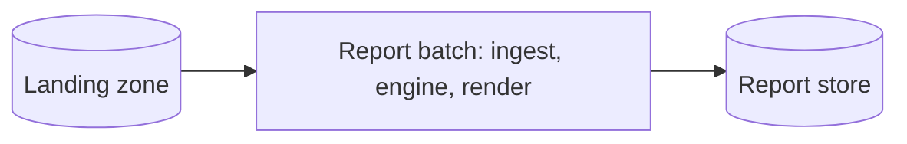
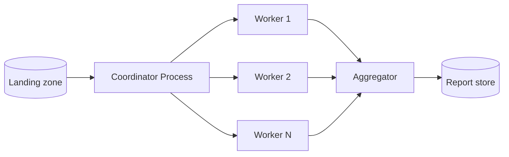
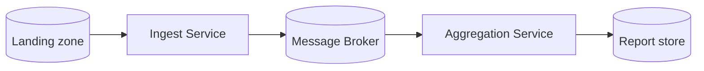

# ATAM-Style Evaluation: Release 1 Architecture

## Business Drivers

* **Timely Delivery:** Produce and deliver the monthly sales report for month $M$ on the morning of the 2nd day of month $M+1$.
* **Scalability & Volume:** Process approximately 3,000,000 transaction rows per month across current and expanding branch locations (PNH, REP, BTB, and new additions).
* **Reliability & Modifiability:** Tolerate intermittent branch internet link disruptions, ensure zero financial calculation errors using `BigDecimal`, and maintain low operational complexity for the team.

## Candidates

### A: Modular Monolith Batch

### B: Process Pipeline

### C: Event-Driven Microservices

## Scenario Analysis Matrix

| Scenario | A: Modular Monolith | B: Process Pipeline | C: Event-Driven Microservices |
| --- | --- | --- | --- |
| **QA-1 (Performance: 3M rows $\le$ 60s)** | **++** Runs multi-threaded in a single JVM with zero network or IPC overhead. | **+** Meets target, though socket/pipe IPC adds serialization overhead. | **-** Risks broker saturation unless events are heavily batched. |
| **QA-2 (Scalability: New branches)** | **+** Easily scales by expanding local thread pools and CPU/RAM allocation. | **+** Scales horizontally on host by spawning extra worker processes on demand. | **++** Excellent scaling; microservices scale independently across nodes. |
| **QA-3 (Availability: Link failures)** | **0** Processes local landing files easily, but lacks built-in distributed retries. | **0** Requires custom orchestration logic to handle missing or late branch files. | **++** Excellent resilience; broker buffers events during link disruptions. |
| **QA-4 (Modifiability: Export changes)** | **+** Strongly typed internal interfaces enable fast, compile-time verified updates. | **0** Changes require updating IPC message formats and process interfaces. | **-** Schema changes require coordinating versions across distributed services. |
| **QA-5 (Security: Branch isolation)** | **+** Enforced via local file system permissions and memory boundaries. | **+** Enforced via OS process boundaries and separate IPC channels. | **-** Broad network surface increases potential inter-service exposure. |
| **QA-6 (Testability: Fast unit tests)** | **++** Fast in-memory testing with JUnit and mock datasets ($<$ 30s execution). | **0** Requires mocking process spawning, local sockets, and pipe communications. | **-** Requires multi-container orchestration and local brokers for integration tests. |
| **Cost and Skills** | **Low:** Single deployable artifact; requires baseline Java development skills. | **Medium:** Requires custom IPC management and OS-level process monitoring skills. | **High:** Requires cloud infrastructure, broker operations, and distributed tracing expertise. |

## QA-1 Quantitative Estimates and Assumptions

### Assumptions

* **Total Workload:** $3,000,000$ rows per month.
* **Parse Rate:** $5\,\mu\text{s}$ per row on a single CPU core (Total serial parse time on 1 core = $15\text{ s}$).
* **Serial Portion ($s$):** Aggregation merge ($2\text{ s}$) + rendering ($1\text{ s}$) = $3\text{ s}$.
* **Hardware:** 8-core CPU server with SSD storage.

### Calculations & Amdahl's Law

* **Candidate A (Modular Monolith Batch):**
Applying Amdahl's Law for the parallelized parsing phase across 8 cores:

$$\text{Time} = \frac{15\text{ s}}{8\text{ cores}} + 3\text{ s (serial)} = 1.875\text{ s} + 3\text{ s} = 4.88\text{ seconds}$$

*(Fits comfortably within the $\le 60\text{ s}$ target).*
* **Candidate B (Process Pipeline):**
4 worker JVM processes with $0.5\text{ s}$ process startup and IPC setup overhead:

$$\text{Time} = 0.5\text{ s (startup)} + \frac{15\text{ s}}{4\text{ workers}} + 3\text{ s (serial)} = 0.5\text{ s} + 3.75\text{ s} + 3\text{ s} = 7.25\text{ seconds}$$

*(Meets the target).*
* **Candidate C (Event-Driven Microservices):**
* *Case 1 (1 row per message @ broker throughput of 50,000 msg/s):*

$$\text{Broker Time} = \frac{3,000,000\text{ messages}}{50,000\text{ msg/s}} = 60.00\text{ seconds}$$

Adding ingestion and rendering time causes it to **fail QA-1**.
* *Case 2 (Batching 1,000 rows per event = 3,000 messages total):*

$$\text{Broker Time} = \frac{3,000\text{ messages}}{50,000\text{ msg/s}} = 0.06\text{ seconds}$$

$$\text{Total Execution Time} \approx 5.00\text{ seconds}$$

*(Meets the target).*

## Sensitivity Points

* **S1 (Parser Thread Pool Size):** In Candidate A, the available worker thread count directly dictates CPU utilization and scaling performance under QA-1.
* **S2 (Branch Link Latency & Transfer Speed):** Network transfer speed for POS CSV files directly dictates ingestion readiness under QA-3.
* **S3 (Message Batch Size):** In Candidate C, changing the message granularity (1 row vs. 1,000 rows per event) impacts broker transit duration under QA-1 by three orders of magnitude ($60\text{ s}$ vs $0.06\text{ s}$).

## Trade-Off Points

* **T1 (Distributed Resilience vs. Performance & Complexity):** Introducing a message broker (Candidate C) buffers late branch files (+QA-3 Availability), but adds serialization overhead, network hops, and operational cost (-QA-1 Performance, -Cost, -QA-5 Security).
* **T2 (Monolithic Simplicity vs. Horizontal Scalability):** Keeping logic in a modular monolith (Candidate A) simplifies localized modifications (+QA-4 Modifiability), but restricts physical scaling across separate network nodes (-QA-2 Scalability).

## Risks, Non-Risks, and Risk Themes

### Risks

* **R1 (Distributed Debugging Complexity):** Under Candidate C, tracing validation errors across decoupled asynchronous services complicates troubleshooting during strict report deadlines.
* **R2 (Message Broker Bottleneck):** In Candidate C, unbatched message delivery can saturate broker queues, causing the generation job to miss the morning deadline.

### Non-Risks

* **NR1 (Single-Node Memory Allocation):** Processing 3 million transaction records fits easily within standard JVM heap limits on an 8-core server.
* **NR2 (CSV Schema Stability):** The POS export schema is well-defined and stable across branch deployments.

### Risk Theme

* **Over-Engineering Premature Distribution:** Adopting microservices or multi-process pipelines before workload volume demands it introduces operational overhead and debugging risks that threaten reliable report delivery.

## Recommendation

The evaluation confirms and reinforces **ADR-0001 (Modular Monolith Batch)** for Release 1. Candidate A achieves the required performance, lowest operational cost, and easiest testability without the network and deployment complexities of distributed architectures. Revisit this decision only when monthly data volume exceeds 10 million rows or physical service separation is required.