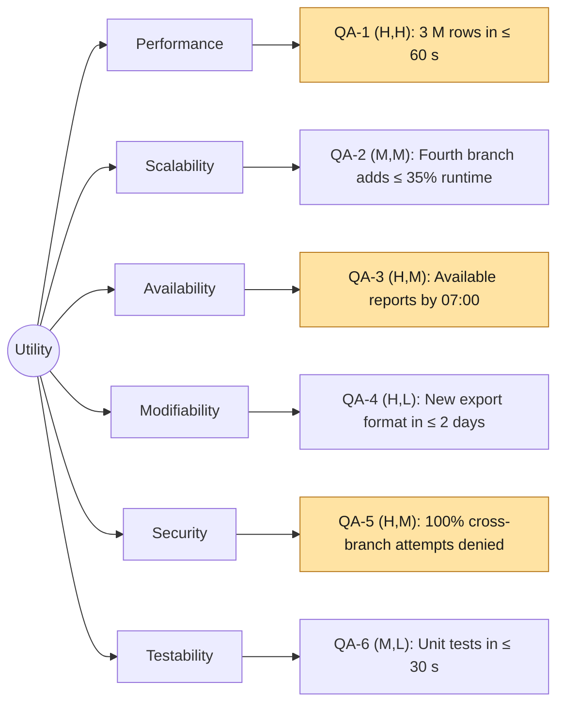

# Quality-attribute scenarios: Angkor Mart monthly sales report

## Stakeholders

- **Head-office analyst:** Views and exports monthly sales reports for all three branches and the whole chain.
- **Branch manager (PNH, REP, BTB):** Views sales reports for their own branch only.
- **Finance director:** Receives an e-mail notification when a monthly report is ready.
- **Operations staff:** Monitors CSV uploads, starts the monthly batch job, and handles missing files or failures.
- **Development team:** Builds, tests, maintains, and extends the report system.

## Scenarios

| ID | Attribute | Source | Stimulus | Artifact | Environment | Response | Response measure | Rank |
|---|---|---|---|---|---|---|---|---|
| QA-1 | Performance | Monthly scheduler at 06:00 on day 2 of M+1 | Starts report generation for approximately 3 million transaction rows | Report batch engine | Normal operation, 8-core server, SSD, complete input files | Processes transactions, writes reports, and publishes a report-ready event | ≤ 60 seconds wall-clock time, median of 5 runs after 2 warm-up runs, measured with a timer | (H,H) |
| QA-2 | Scalability | Business management | Adds a fourth branch with approximately 1 million additional rows per month | Ingestion and report engine | Normal operation, same 8-core server and input format | Processes the additional branch without architectural changes | Runtime increase ≤ 35% compared with the 3-branch baseline, using medians of 5 runs after 2 warm-up runs | (M,M) |
| QA-3 | Availability | REP branch POS system | Internet failure delays the final REP daily CSV by 2 hours | Landing zone, ingest job, report scheduler | Month-end reporting, PNH and BTB files available, REP file missing | Produces available branch reports, marks the chain report partial, and incorporates REP data after arrival | Available branch reports published by 07:00 on day 2; corrected report within 15 minutes of late-file arrival, measured from timestamps in job logs | (H,M) |
| QA-4 | Modifiability | Development team | Client requests an additional report export format | ReportRenderer strategy and report engine | Existing application, automated tests available | Implements the new format without modifying transaction models or ingestion logic | New format implemented and tested in ≤ 2 developer-days, measured using tracked work time and Git changes | (H,L) |
| QA-5 | Security | Authenticated branch manager | PNH manager attempts to access REP or BTB reports through the web interface or direct URL | Authentication and report authorization | Normal operation, role-based access enabled | Rejects unauthorized access without exposing other branches' report content | 100% of 100 cross-branch access attempts denied, with HTTP 403 and zero unauthorized report bytes returned, measured by automated integration tests | (H,M) |
| QA-6 | Testability | Development team / CI pipeline | Runs automated model, parser, loader, renderer, and dependency tests | Maven project and JUnit test suite | Clean build environment, dependencies cached, no external services | Executes tests and reports failures automatically | All unit tests finish in ≤ 30 seconds in each of 5 CI runs, measured using Maven Surefire reports | (M,L) |

## Rank justifications

- **QA-1 (H,H):** The monthly report must be ready in the morning, and processing approximately 3 million rows with BigDecimal aggregation creates significant performance challenges.
- **QA-2 (M,M):** Supporting more branches is valuable for business growth, but the initial system only has three branches and can use additional processing capacity later.
- **QA-3 (H,M):** Unreliable branch internet connections must not prevent head office from receiving available reports, although missing-file detection and safe reprocessing require additional design.
- **QA-4 (H,L):** The client requires PDF, Excel, and web outputs, making extensibility important, while the Strategy pattern makes new formats relatively easy to add.
- **QA-5 (H,M):** Branch managers must never access other branches' financial information, and enforcing authorization across report access paths requires careful implementation.
- **QA-6 (M,L):** Fast automated tests help prevent defects throughout the semester, and separating business logic from external systems makes this comparatively straightforward.

## Assumptions

- **A1:** The production report server has 8 CPU cores, an SSD, and sufficient RAM for processing the monthly dataset.
- **A2:** The three branches generate approximately 3 million transaction rows in a typical 30-day month.
- **A3:** The fourth branch has approximately the same transaction volume as an existing branch.
- **A4:** The report scheduler begins at 06:00 on the second day of the following month.
- **A5:** A partial report is acceptable when a branch file is late, provided missing data is clearly identified. This requires client confirmation.
- **A6:** Available branch reports must be published by 07:00, and corrected reports within 15 minutes after late data arrives. These are proposed service targets requiring client approval.
- **A7:** Report export formats share the same business model and aggregation engine.
- **A8:** Authentication and branch-based authorization will be implemented in later labs. QA-5 is a release-level target, not a feature completed in Lab-01.
- **A9:** Automated unit tests run on a CI machine with dependencies already cached and do not require external services.
- **A10:** Performance targets are proposed acceptance criteria and must be verified through benchmarks, not assumed to have been achieved.

## Utility tree

## Architectural drivers

The architectural drivers are scenarios ranked **(H,H)** or **(H,M)**:

1. **QA-1 — Performance (H,H):** Process approximately 3 million rows within 60 seconds.
2. **QA-3 — Availability (H,M):** Continue reporting when a branch's CSV file arrives late.
3. **QA-5 — Security (H,M):** Enforce branch-specific report access.

These drivers influence architectural decisions such as batch processing, reliable file ingestion, idempotent reprocessing, and authorization.

**Note:** The response measures are proposed engineering targets derived from the brief and explicit assumptions. They require client approval and later validation.
